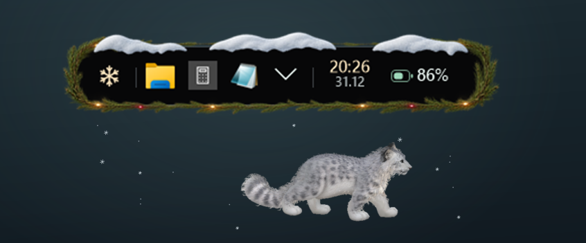
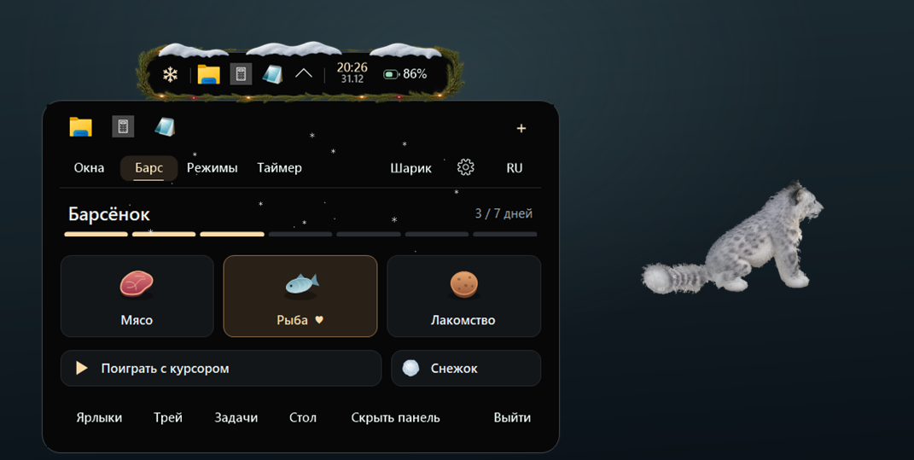
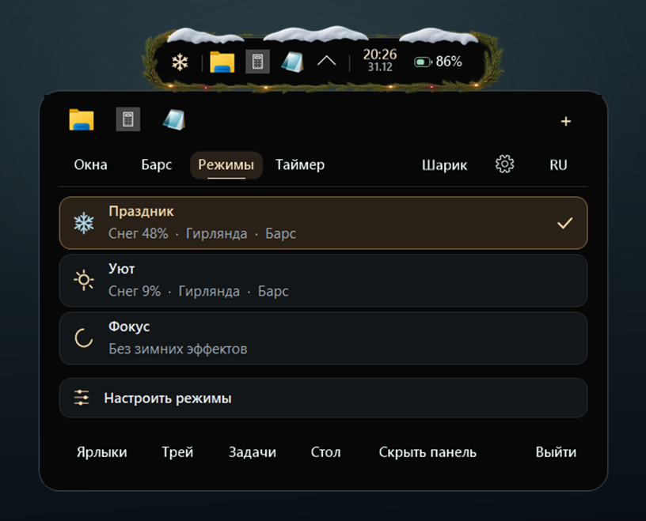
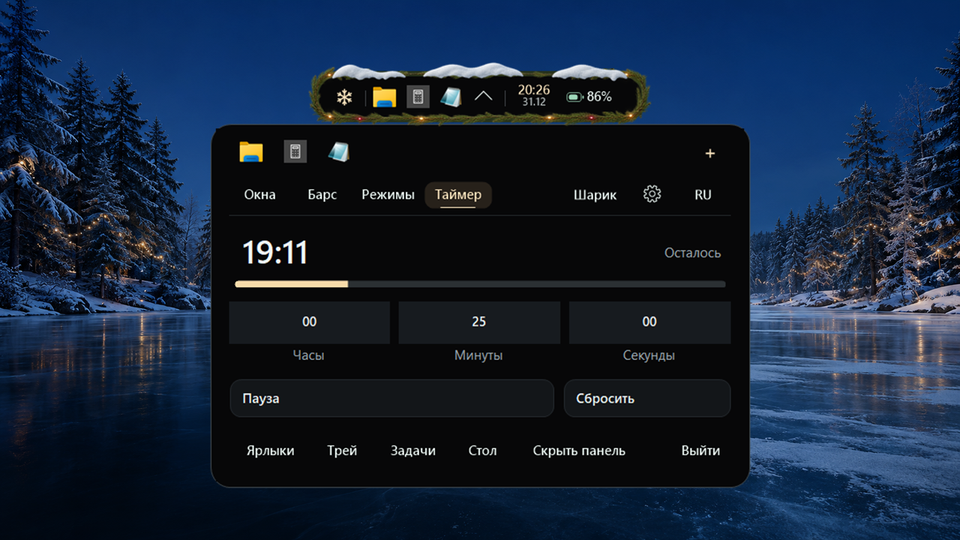

# Happy New Island

**Новогодний подгон для рабочего стола.** Заснеженный остров у верхнего края экрана и маленький 3D-барс, который гуляет, засыпает рядом и радуется, когда его гладишь.

[English](docs/README.en.md) · [Последний релиз](https://github.com/wpotoke/happy-new-island/releases/latest) · [Видео](#видео)

## Скачать

| Система | Готовая сборка | Как открыть |
| --- | --- | --- |
| **Windows x64** | [ZIP](https://github.com/wpotoke/happy-new-island/releases/latest/download/HappyNewIsland-Windows-x64.zip) | Распакуй и запусти `HappyNewIsland.exe`. |
| **macOS Apple Silicon / Intel** | [Apple Silicon](https://github.com/wpotoke/happy-new-island/releases/latest/download/HappyNewIsland-macOS-arm64.zip) · [Intel](https://github.com/wpotoke/happy-new-island/releases/latest/download/HappyNewIsland-macOS-x64.zip) | Распакуй архив и открой `Happy New Island.app`. |
| **Linux x64 / ARM64** | [x64](https://github.com/wpotoke/happy-new-island/releases/latest/download/HappyNewIsland-linux-x64.tar.gz) · [ARM64](https://github.com/wpotoke/happy-new-island/releases/latest/download/HappyNewIsland-linux-arm64.tar.gz) | Распакуй архив и запусти `./HappyNewIsland` из получившейся папки. |

Для macOS и Linux среда .NET уже в архиве. Сборки проверяются на macOS 15 и Ubuntu 24.04. Для Linux нужна графическая сессия X11 или XWayland. На Wayland открывается обычная панель, а барс живёт во вкладке **«Барс»**.

Сборки macOS имеют локальную подпись. Если macOS просит подтвердить запуск из-за отсутствия нотариального заверения Apple, смотри инструкцию для доверенного приложения. [Поддержка Apple](https://support.apple.com/ru-ru/102445)

## Как пользоваться

На Windows остров прячется, если перекрывает интерфейс другого окна. Задержи мышь в центре верхнего края, чтобы вызвать его. На macOS и Linux с X11 остров прячется после ухода курсора. **Ctrl+Alt+G** (на Mac **Ctrl+⌥+G**) закрепляет или прячет его. Открыть панель также можно через значок приложения в трее или строке меню.

| Раздел | Что в нём |
| --- | --- |
| **Окна / Приложения** | Закрепляй и открывай приложения, меняй порядок ярлыков и перетаскивай на них файлы. На Windows можно переключаться между открытыми окнами. |
| **Барс** | Покорми его мясом, рыбой или лакомством. За семь дней кормления он вырастет. На рабочем столе он ходит, засыпает, зевает и потягивается, при поглаживании пускает сердечки, а в игре крадётся и прыгает за мышкой. |
| **Снежок** | Веди ракетку мышью и отбивай снежок в остров. На Windows есть отдельная игра со снежком для барса. |
| **Режимы** | **Праздник** добавляет снег, сугробы и мерцающую гирлянду. В **Уюте** снег и огоньки спокойнее. **Фокус** убирает декор. Эффекты можно переключать отдельно. |
| **Таймер** | Задай часы, минуты и секунды. Есть пауза, продолжение, сброс и полоска прогресса под часами. |

В свёрнутом острове видны время, дата, заряд доступной батареи и первые закреплённые приложения. Полная дата видна при наведении.

- **Windows.** Медиакарточка с названием, обложкой и кнопками управления. Счётчик Telegram красный, если есть непрочитанное с уведомлениями, и серый, если остались только тихие чаты. Число следует настройкам самого Telegram. Снег копится на окнах и шерсти, его можно смахивать. Можно скрыть системную панель задач из меню острова и вернуть её через **Ctrl+Alt+Shift+T**.
- **Linux.** Кнопки воспроизведения работают через `playerctl` с поддерживаемыми плеерами. Ярлыки `.desktop` открываются через `gio`.
- **macOS и Linux.** Общий 3D-барс, часы, таймер, закреплённые приложения и режимы. Прозрачные эффекты и игры на рабочем столе зависят от оконной системы.

## Видео

https://github.com/user-attachments/assets/830508d4-3fea-4ed8-bd1a-c4a1a59ef149

**1:14** · [Скачать MP4](https://github.com/wpotoke/happy-new-island/releases/download/v1.21.1/HappyNewIsland-full-demo.mp4)

Барс гуляет, пускает сердечки от поглаживания, ест, спит и прыгает за курсором. На **0:34** он задевает остров хвостом, и по гирлянде пробегает волна света. На **0:40** он толкает снежок лапой, на **0:46** снежок отбивается ракеткой. С **0:53** видно, как смахнуть снег с окна, а с **1:00** — как барс стряхивает его с шерсти. Пауза сна сокращена, накопление снега ускорено.

## Скриншоты

| Режимы оформления | Таймер фокуса |
| --- | --- |
|  |  |

## Исходники

`windows/` — нативная панель WinForms. `desktop/` — версии для macOS и Linux на Avalonia с тем же 3D-рендером и анимациями. Скрипты сборки лежат в [scripts](scripts), а [GitHub Actions](https://github.com/wpotoke/happy-new-island/actions) собирает и проверяет архивы для релизов.

[Сторонние компоненты](THIRD-PARTY-NOTICES.md) · [Контрольные суммы](https://github.com/wpotoke/happy-new-island/releases/latest/download/SHA256SUMS.txt)
