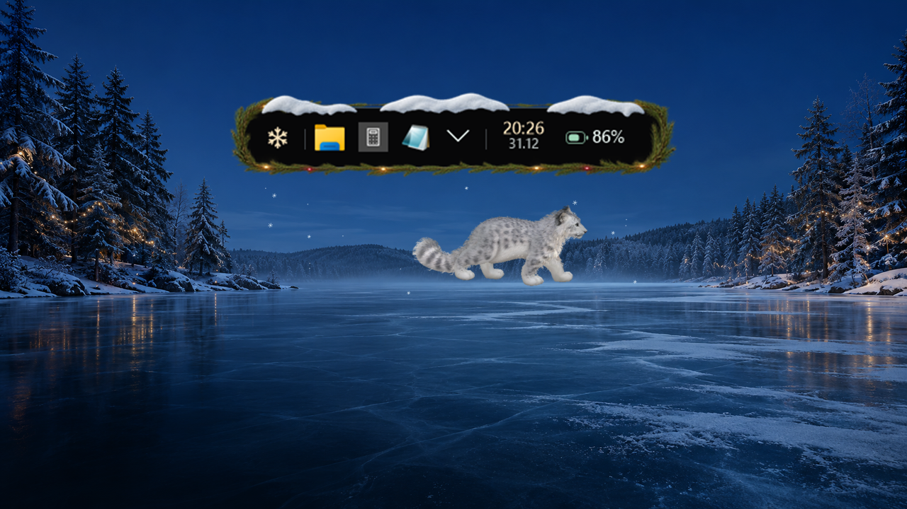
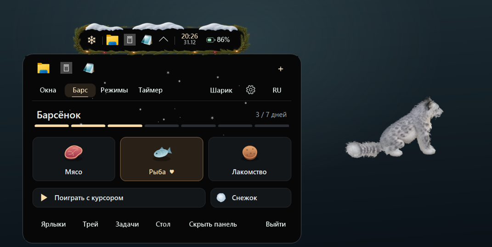
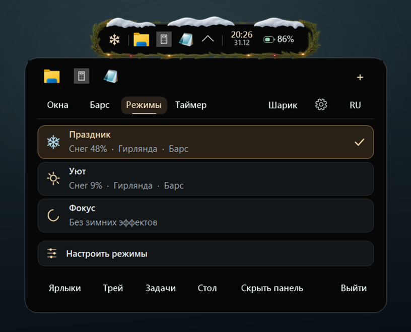
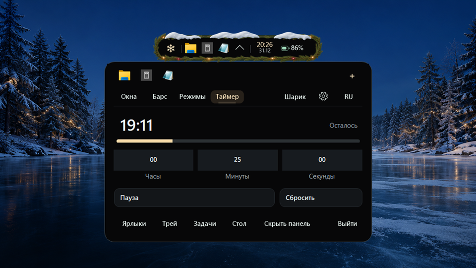

# Happy New Island

**A little New Year’s gift for your desktop.** A snow-covered island at the top of your screen, with a tiny 3D snow leopard that wanders, naps beside it, and throws hearts when you pet it.

[Русский](../README.md) · [Latest release](https://github.com/wpotoke/happy-new-island/releases/latest) · [Video](#video)

## Download

| System | Download | Open |
| --- | --- | --- |
| **Windows x64** | [ZIP](https://github.com/wpotoke/happy-new-island/releases/latest/download/HappyNewIsland-Windows-x64.zip) | Extract the ZIP and run `HappyNewIsland.exe`. |
| **macOS Apple Silicon / Intel** | [Apple Silicon](https://github.com/wpotoke/happy-new-island/releases/latest/download/HappyNewIsland-macOS-arm64.zip) · [Intel](https://github.com/wpotoke/happy-new-island/releases/latest/download/HappyNewIsland-macOS-x64.zip) | Unzip and open `Happy New Island.app`. |
| **Linux x64 / ARM64** | [x64](https://github.com/wpotoke/happy-new-island/releases/latest/download/HappyNewIsland-linux-x64.tar.gz) · [ARM64](https://github.com/wpotoke/happy-new-island/releases/latest/download/HappyNewIsland-linux-arm64.tar.gz) | Extract the archive and run `./HappyNewIsland` in the resulting folder. |

The macOS and Linux archives include the .NET runtime. Builds are checked on macOS 15 and Ubuntu 24.04. Linux needs an X11 or XWayland session. On Wayland, the island opens as a regular window and the leopard appears in the **Leopard** tab.

The macOS builds are ad hoc signed. If macOS asks you to approve the unnotarized app on first launch, follow Apple’s instructions for an app you trust. [Apple Support](https://support.apple.com/en-us/102445)

## Using the island

On Windows, the island hides when it would cover the interface of another window. Hover at the middle of the top edge to bring it back. On macOS and Linux with X11, it hides after you move the pointer away. **Ctrl+Alt+G** (**Ctrl+⌥+G** on Mac) pins or hides it. You can also open it from the tray or menu bar.

| Section | What it does |
| --- | --- |
| **Windows / Apps** | Pin, reorder and launch shortcuts. Drop files onto app shortcuts. On Windows, switch between open windows. |
| **Leopard** | Feed meat, fish or a treat. The cub grows over seven feeding days. On the desktop it walks, curls up to sleep, yawns, stretches, sends hearts when petted, and stalks or pounces after the pointer. |
| **Snowball** | Move the paddle with your mouse and bounce a snowball into the island. Windows also has a separate snowball toy for the leopard. |
| **Modes** | **Holiday** has snowfall, snowdrifts and twinkling lights. **Cozy** softens the snow and lights. **Focus** clears away the decorations. Effects have individual switches. |
| **Timer** | Set your own hours, minutes and seconds. Pause, resume or reset, and see progress under the clock. |

The compact island shows the time, date, battery level when available, and your first pinned apps. Hover over the clock for the full date.

- **Windows.** Now Playing shows media artwork, the title and playback controls. The Telegram badge is red when there are unmuted unread chats and gray when only muted unread remains. Its count follows Telegram’s settings. Snow can settle on windows and fur and be brushed off. The taskbar can be hidden from the island menu and restored with **Ctrl+Alt+Shift+T**.
- **Linux.** Playback controls work with compatible media players through `playerctl`. App shortcuts use `gio` to launch `.desktop` entries.
- **macOS and Linux.** Both have the 3D pet, clock, timer, launcher and winter modes. Desktop overlays and games depend on your window system.

## Video

https://github.com/user-attachments/assets/3fdd99ec-0f75-4aaf-bb4d-d0061b96504a

**1:27** · [Download MP4](https://github.com/wpotoke/happy-new-island/releases/download/v1.21.1/HappyNewIsland-full-demo.mp4)

The video shows the Windows version. The leopard walks, sends hearts when petted, eats, naps, and pounces after the pointer.

- **0:08** — the island hides when another app overlaps it. **0:10** — hold the pointer at the center of the top edge to bring it back. **0:15** — Ctrl + Alt + G pins the island above the window.
- **0:47** — a tail tap lights up the garland. **0:53** — the leopard bats a snowball. **0:59** — the paddle game starts, and at **1:01** the snowball bounces off the leopard, who shakes off the snow.
- **1:06** — snow gathers on a window and you can sweep it away with the pointer. **1:13** — snow gathers on the leopard's fur and it shakes the snow off.

The nap is shortened and snow accumulates faster in the demo.

## Screenshots

| Winter modes | Focus timer |
| --- | --- |
|  |  |

## Source

`windows/` contains the native WinForms app. `desktop/` contains the Avalonia port for macOS and Linux, sharing the 3D renderer and character animation. The [build scripts](../scripts) package the app, and [GitHub Actions](https://github.com/wpotoke/happy-new-island/actions) builds and checks the release archives.

[Third-party notices](../THIRD-PARTY-NOTICES.md) · [Checksums](https://github.com/wpotoke/happy-new-island/releases/latest/download/SHA256SUMS.txt)
